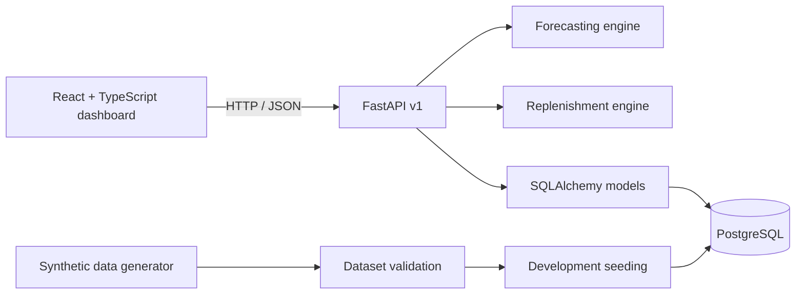

# Architecture

## System overview

YottaFlex is a local decision-support application for retail demand forecasting
and replenishment planning. The React application reads and updates state
through a versioned FastAPI API. The API uses SQLAlchemy models and PostgreSQL
for persisted catalog, demand, inventory, forecast, recommendation, and
exception data.

## Components

### Frontend

`frontend/` contains the Vite-hosted React application. `src/App.tsx` provides
the seven application areas and navigation. `src/lib/api.ts` centralizes the
API base URL, query parameters, JSON requests, and HTTP/network error handling.
The pages display API-backed data with loading, empty, and error states.

The application does not use a dashboard mock-data fallback. Unit tests may
mock the API module at the component boundary; normal application execution
continues to call FastAPI.

### Backend

`backend/app/main.py` configures the FastAPI application, CORS, and API router.
Versioned routes under `backend/app/api/v1/` expose catalog, inventory, sales,
forecast, replenishment, recommendation, exception, overview, and health
operations.

The forecasting and replenishment engines are called by API operations. These
operations are synchronous; there is no separate job queue or worker service.

### Persistence and migrations

SQLAlchemy models in `backend/app/models/` define entity fields and
relationships. Alembic revisions in `backend/alembic/versions/` evolve the
schema. Schema changes must be reviewed and applied explicitly; starting the
API is not a substitute for running Alembic.

Recommendation history uses nullable supersession metadata and a PostgreSQL
partial unique index to enforce one active recommendation per SKU, store, and
recommendation date. The index does not delete historical recommendations.
When upgrading an older database with active duplicates, the planner must
choose the canonical record and preserve the other through an explicit
supersession decision before the uniqueness revision can succeed.

### Data preparation

`backend/app/engines/data_generator/` provides deterministic development and
full dataset profiles. `scripts/seed_data.py` validates and seeds the
development database. Generated data, local environment files, and frontend
build output are excluded from Git by `.gitignore`.

## Local request flow

1. A page calls the shared API client in `frontend/src/lib/api.ts`.
2. The client sends a JSON HTTP request to the configured `VITE_API_URL`.
3. FastAPI applies CORS and request validation, dispatches to the route, and
   uses a request-scoped SQLAlchemy session for persistence.
4. The route returns a response model; the page renders the returned data or
   displays an explicit loading, empty, or error state.

The API has no authentication or role-based authorization in the current
project. It is intended for local development and project submission, not
production deployment.

## Local service addresses

- Frontend: `http://localhost:5173`
- API: `http://127.0.0.1:8000`
- OpenAPI documentation: `http://localhost:8000/docs`

See the root [README](../README.md) for environment setup, migration, seed,
test, and run commands.
