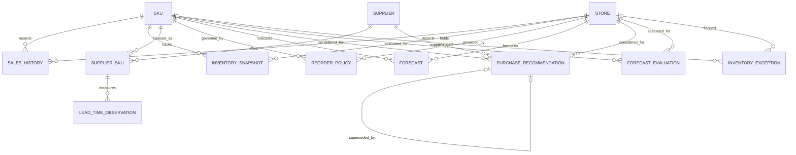

# Entity Relationships

Database UUIDs and integer keys are internal primary keys. Human-readable
`sku_code`, `store_code`, and `supplier_code` values identify master records
for users and integrations; they are not substitutes for database foreign
keys.

## Relationship and lifecycle notes

| Entity | Cardinality and key rules |
|---|---|
| SKU | One SKU may have many sales, inventory snapshots, supplier contracts, reorder policies, forecasts, and recommendations. `sku_code` is unique. |
| Store | One store may have many sales, snapshots, policies, forecasts, and recommendations. `store_code` is unique. |
| SalesHistory | One daily row per SKU, store, and sale date. Both parent references are required. |
| InventorySnapshot | One daily row per SKU, store, and snapshot date. Both parent references are required. |
| Supplier | One supplier may offer many SKUs through `SupplierSKU` and may be named on many recommendations. `supplier_code` is unique. |
| SupplierSKU | Bridge entity for the many-to-many supplier/SKU relationship. A supplier/SKU pair is unique and carries contract terms. |
| LeadTimeObservation | Many observations belong to one supplier/SKU contract. The supplier/SKU reference is required. |
| Forecast | Many forecasts belong to one SKU/store pair; a forecast identifies its model, origin date, target date, and horizon. |
| ReorderPolicy | One policy per SKU/store pair. Both references are required. |
| PurchaseRecommendation | A recommendation references one SKU, store, and supplier. Several historical rows may exist for a cycle, but at most one row may be active. A superseded row points to its replacement. |

Forecast evaluations and inventory exceptions are supporting operational
entities. Evaluation rows are linked to a SKU/store pair. Exceptions may be
network-wide or reference a SKU and/or store, depending on the exception.

## Delete behavior

Foreign-key delete rules differ by relationship. Historical sales, inventory,
supplier-contract, lead-time, forecast, and policy data generally use
restrictive or cascading behavior as declared on their SQLAlchemy foreign
keys. Recommendations use restrictive references so deleting a parent cannot
silently erase a decision record. Prefer deactivating master records over
deleting records that have business history.

The database schema is authoritative for exact nullability, foreign keys,
unique constraints, and delete rules. See the [data dictionary](data_dictionary.md)
and the model definitions in `backend/app/models/`.
